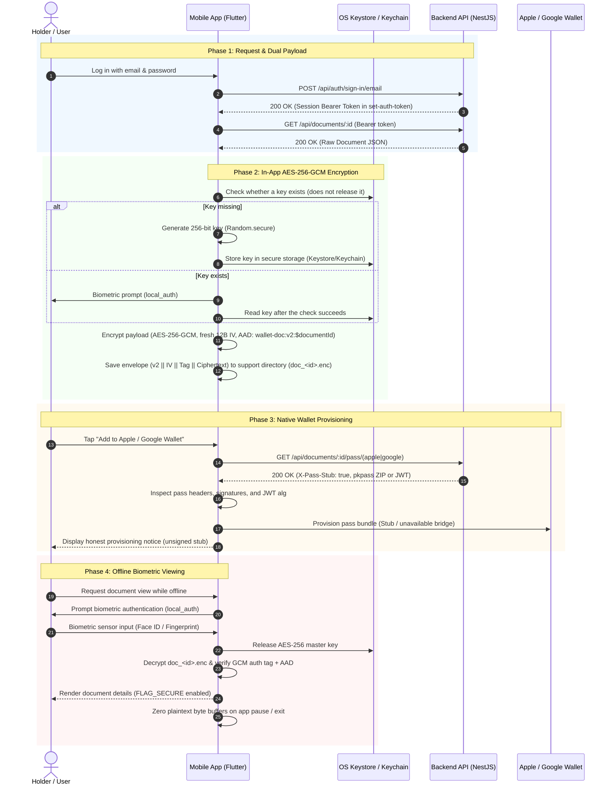

# Secure Digital Identity Wallet

A secure, offline-first digital identity wallet system designed for provisioning, managing, and presenting digital identity credentials (such as driving licenses).

The solution consists of:
- **Backend API (`backend/`)**: Built on NestJS 12, Drizzle ORM with SQLite (WAL mode), and Better-Auth session management. Exposes identity document endpoints, administrative management APIs, and native wallet pass generators.
- **Admin Portal (`admin/`)**: A web management portal built on React 19, Vite, and Ant Design v6. Provides user inspection, document issuance, and document revocation.
- **Mobile Application (`mobile/`)**: Cross-platform Flutter application providing local AES-256-GCM encrypted document storage, platform Keystore/Keychain integration, and biometric presentation gating.
- **API Documentation (`backend/docs/`)**: API reference pages written as Mintlify MDX (there is no OpenAPI spec).

---

## Architecture & Sequence Flow

The core lifecycle of an identity credential follows a 4-phase flow:
1. **Request & Dual Payload**: The authenticated client requests identity credentials and receives both the raw verifiable document claims and native wallet pass metadata.
2. **In-App AES-256-GCM Encryption**: The mobile client encrypts the raw document using a device-generated AES-256-GCM key stored with `flutter_secure_storage` (Android Keystore-backed storage / iOS Keychain), bound to the document identifier with Additional Authenticated Data (AAD).
3. **Native Wallet Provisioning**: The client inspects pass bundles from the backend and surfaces pass provisioning state.
4. **Offline Biometric Viewing**: Viewing decrypted credentials requires a `local_auth` biometric check in app code before the key is read. This is an app-level gate, not an OS-enforced key binding (see Status and limitations).



---

## Screenshots

### Admin Portal

| Screenshot | Description |
| :---: | :--- |
|  | **Admin Login**: Sign-in page with empty credentials in light theme. |
|  | **Users Management**: Table listing registered fictional users and their active credential counts. |
|  | **Issue Document**: Dialog form for issuing a driving license credential. |
|  | **Documents Overview (Dark Mode)**: Credential status list showing issued and revoked records. |

### API Documentation

| Screenshot | Description |
| :---: | :--- |
|  | **Introduction**: System overview and architecture guide in Mintlify. |
|  | **Endpoint Reference**: Request and response example for the raw document JSON that the mobile app encrypts. |

### Mobile Application

| Screenshot | Description |
| :---: | :--- |
|  | **Mobile Login**: Initial user authentication screen. |
|  | **Wallet Home (Light Mode)**: Issued driving license card with offline caching and wallet actions. |
|  | **Wallet Home (Dark Mode)**: Credential dashboard in iOS system dark appearance. |
|  | **Decrypted Document Viewer**: Presentation view displaying decrypted identity claims. |

All credential claims, names, and identifiers displayed are fictional demonstration data. Biometric authentication was simulated using a controllable provider in the iOS Simulator for the viewer screen.

---

## Repository Layout

```text
wallet-secure-directory/
├── README.md                      # Monorepo architecture & setup guide
├── scripts/
│   ├── dev.sh                     # Orchestrated local development startup script
│   ├── stop.sh                    # Stop running development processes
│   └── .gitignore                 # Git ignore rules for scripts directory
├── backend/                       # NestJS 12 API service
│   ├── src/                       # NestJS controllers, services, modules
│   ├── test/                      # Vitest e2e and unit test suites
│   ├── drizzle/                   # Drizzle SQLite migration SQL files
│   ├── data/                      # Local SQLite WAL database storage
│   ├── scripts/                   # Database seed utilities (seed-admin.ts)
│   ├── docs/                      # Mintlify documentation workspace
│   │   ├── mint.json              # Mintlify canonical navigation & API config
│   │   ├── .gitignore             # Ignores generated docs.json
│   │   └── api-reference/         # Endpoint MDX guides
│   ├── package.json
│   └── .env.example               # Environment variables template
├── admin/                         # Vite React Ant Design administrative portal
│   ├── src/                       # React components, pages, API clients
│   ├── vite.config.ts             # Vite dev server configuration & /api proxy
│   └── package.json
├── mobile/                        # Flutter mobile application
│   ├── lib/                       # Riverpod state, UI screens, crypto & storage services
│   ├── test/                      # Flutter unit and widget tests
│   ├── android/                   # Android native project configuration
│   ├── ios/                       # iOS native project configuration
│   ├── SECURITY.md                # Security architecture & cryptographic specifications
│   └── pubspec.yaml
└── docs/                          # Specifications and reviews
    ├── API_CONTRACT.md            # Canonical API wire contract
    ├── reviews/                   # Security audits & code reviews
    └── theme/                     # Design tokens & color palettes
```

---

## Prerequisites

- **Node.js**: v24.x (verified on `v24.22.1` with `npm 11.x`)
- **Flutter**: v3.41.x (verified on Flutter `3.41.9` / Dart `3.11.5`)
- **OpenSSL**: For generating secure authorization secrets (`openssl rand -base64 32`)
- **Xcode & Command Line Tools** *(Optional)*: Required for iOS Simulator builds on macOS
- **Android SDK & Command Line Tools** *(Optional)*: Required for Android Emulator builds

---

## Quickstart

### Option A: Automated One-Command Startup (Recommended)

Run the root dev script, which validates dependencies, bootstraps `.env` if missing, runs database migrations, builds the backend, and launches both services:

```bash
./scripts/dev.sh
```

To include Mintlify documentation server preview:
```bash
./scripts/dev.sh --docs
```

To seed an initial admin account during startup:
```bash
./scripts/dev.sh --seed-admin admin@example.com
```

To stop all services:
```bash
./scripts/stop.sh
# Or run: ./scripts/dev.sh --stop
```

---

### Option B: Step-by-Step Manual Setup (Verified)

#### 1. Install Dependencies

```bash
# Backend dependencies
cd backend && npm install

# Admin portal dependencies
cd ../admin && npm install

# Mobile app dependencies
cd ../mobile && flutter pub get
cd ..
```

#### 2. Configure Backend Environment

Copy the example configuration and generate a 32-byte secret for Better-Auth:

```bash
cp backend/.env.example backend/.env

# Generate a cryptographically secure 32-byte key
SECRET=$(openssl rand -base64 32 | tr -d '\n')

# Populate BETTER_AUTH_SECRET in backend/.env
# On macOS:
sed -i '' "s|^BETTER_AUTH_SECRET=.*|BETTER_AUTH_SECRET=${SECRET}|" backend/.env
# On Linux:
# sed -i "s|^BETTER_AUTH_SECRET=.*|BETTER_AUTH_SECRET=${SECRET}|" backend/.env
```

#### 3. Run Database Migrations

Apply database schemas to the SQLite database:

```bash
cd backend
npm run db:migrate
```

#### 4. Seed Administrative User

Create the initial administrative account:

```bash
ADMIN_EMAIL="admin@example.com" \
ADMIN_PASSWORD="YourSecurePassword123!" \
ADMIN_NAME="Administrator" \
npm run seed:admin
```

> The password above is only an example for local development. Choose your own, and never reuse it on a deployed instance.

#### 5. Build and Start the Backend

```bash
npm run build
npm run start:prod
# Output: Nest application successfully started on port 3000
```

#### 6. Start the Admin Portal

In a new terminal:

```bash
cd admin
npm run dev
# Vite runs at http://localhost:5173 with proxy configured for /api -> http://localhost:3000
```

#### 7. Start API Documentation Preview

In a new terminal:

```bash
cd backend/docs
npx -y mint@latest dev --port 3333
# Documentation served at http://localhost:3333
```

#### 8. Run Mobile Application

In a new terminal:

```bash
cd mobile

# Running in macOS Desktop / iOS Simulator:
flutter run --dart-define=API_BASE_URL=http://localhost:3000

# Running in Android Emulator (Android maps host localhost to 10.0.2.2):
flutter run --dart-define=API_BASE_URL=http://10.0.2.2:3000
```

---

## Ports Table

| Port | Service | Description | URL |
| :--- | :--- | :--- | :--- |
| **3000** | Backend API | NestJS 12 REST API, Better-Auth endpoints, Wallet pass endpoints | `http://localhost:3000` |
| **5173** | Admin Portal | Vite React 19 + Ant Design dashboard (proxies `/api` to 3000) | `http://localhost:5173` |
| **3333** | Mintlify Docs | Mintlify local documentation preview server | `http://localhost:3333` |

---

## Environment Variables (`backend/.env`)

Refer to [`backend/.env.example`](backend/.env.example) for baseline configuration:

| Variable | Required | Default (Dev) | Description |
| :--- | :---: | :--- | :--- |
| `NODE_ENV` | Yes | `development` | Runtime environment (`development`, `production`, `test`). |
| `PORT` | Yes | `3000` | Port for the NestJS HTTP listener. |
| `DATABASE_PATH` | Yes | `./data/wallet.db` | Relative or absolute path to SQLite database file. WAL mode is enabled automatically. |
| `BETTER_AUTH_SECRET` | Yes | *Generated* | Cryptographic signing secret for Better-Auth tokens (minimum 32 characters). |
| `BETTER_AUTH_URL` | Yes | `http://localhost:3000` | Base URL used by Better-Auth for callbacks and session validation. |
| `TRUSTED_ORIGINS` | Yes | `http://localhost:5173` | Comma-delimited CORS allowed origins for credentials access. |
| `TRUST_PROXY_HOPS` | Yes (in Prod) | `0` | Number of reverse proxy hops in front of the application. |

> [!IMPORTANT]
> **Production Rule for `TRUST_PROXY_HOPS`**:
> In production (`NODE_ENV=production`), `TRUST_PROXY_HOPS` **must be set explicitly** (e.g., `1` when behind Cloudflare, Nginx, or an AWS ALB; `0` if directly exposed).
> **Consequence of misconfiguration**: If set to `0` while operating behind a reverse proxy, rate-limiting algorithms key on the reverse proxy socket IP instead of downstream client IPs. This collapses all end-users into a single IP bucket, triggering collective client lockouts.

---

## Verification & Test Commands

Every component in the repository has dedicated test suites:

| Project | Command | Framework |
| :--- | :--- | :--- |
| **Backend** | `cd backend && npm run typecheck && npm test` | Vitest (e2e against a temporary SQLite database, plus unit tests) |
| **Admin** | `cd admin && npm test` | Vitest + Testing Library |
| **Mobile** | `cd mobile && flutter analyze && flutter test` | Flutter Test (unit and widget tests with fakes) |

---

## API Summary

The canonical contract for all endpoints is maintained in [`docs/API_CONTRACT.md`](docs/API_CONTRACT.md).

### Core Endpoints Overview

- **Authentication (`/api/auth`)**:
  - `POST /api/auth/sign-up/email`: Register user with `{ name, email, password }`.
  - `POST /api/auth/sign-in/email`: Authenticate user; returns session token and sets `set-auth-token` header.
  - `GET /api/auth/get-session`: Retrieve active user session.
  - `POST /api/auth/sign-out`: Terminate session and invalidate auth cookies/tokens.
- **Service Endpoints (`/api`)**:
  - `GET /api/health`: Health status and SQLite journal mode (`{"status":"ok","journalMode":"wal"}`).
  - `GET /api/me`: Returns current authenticated user record.
- **Identity Document Endpoints (`/api/documents`)**:
  - `GET /api/documents`: List user's active, non-revoked identity documents.
  - `GET /api/documents/:id`: Retrieve raw JSON claims of a specific document for mobile encryption.
  - `GET /api/documents/:id/pass/apple`: Download Apple `.pkpass` bundle (carries `X-Pass-Stub: true`).
  - `GET /api/documents/:id/pass/google`: Retrieve Google Wallet save URL & JWT (stub payload).
- **Administrative Endpoints (`/api/admin`)** *(Requires `role: "admin"`)*:
  - `GET /api/admin/users`: Paginated list of users with active document counts.
  - `GET /api/admin/documents`: Paginated list of issued documents across all users.
  - `POST /api/admin/documents`: Issue a new document to a specified `userId`.
  - `POST /api/admin/documents/:id/revoke`: Revoke an issued document (idempotent).

---

## Status and Limitations

To maintain full engineering transparency, the following constraints and current implementation limitations are explicitly documented:

1. **Unsigned Wallet Pass Stubs**:
   - The Apple Wallet pass endpoint (`/api/documents/:id/pass/apple`) generates a zipped `.pkpass` bundle containing `pass.json` and `manifest.json`, but **does not contain a cryptographic signature**. Real Apple Wallet pass signing requires an active Apple Developer Team Account, a registered Pass Type ID certificate, and the Apple Worldwide Developer Relations (WWDR) intermediate certificate chain.
   - The Google Wallet pass endpoint (`/api/documents/:id/pass/google`) outputs a stub JWT using unsigned header `alg: none`. Real Google Wallet pass provisioning requires an approved Google Pay & Wallet Console Issuer ID and an authorized Google Cloud Service Account with credentials.
   - The mobile application's native wallet bridge is currently an `UnavailableNativeWalletBridge` and detects stubs via `X-Pass-Stub: true`, absent zip signatures, or `alg: none`, honestly presenting this limitation to the user.
2. **App-Level Biometric Gating vs. OS-Bound Keys**:
   - As detailed in [`mobile/SECURITY.md`](mobile/SECURITY.md), the biometric gate in the mobile app is implemented via `local_auth` in Flutter Dart code (`biometricOnly: true`).
   - The symmetric key stored in Android Keystore / iOS Keychain is **not hardware-bound** to the biometric state via OS-level primitives (`KeyGenParameterSpec.setUserAuthenticationRequired(true)` on Android or `SecAccessControl` with `kSecAccessControlBiometryCurrentSet` on iOS). A compromised device (e.g. rooted/jailbroken) could theoretically bypass the Dart application-level boolean check.
3. **Hardware-Level Security Testing Limitations**:
   - Security features including biometric authentication, Android `WindowManager.LayoutParams.FLAG_SECURE` screen recording prevention, iOS `SceneDelegate` privacy snapshot overlays, and native wallet presentation sheets were verified in automated unit test suites and simulators/emulators, but **have not yet been validated on physical production hardware**.
4. **Android Release Build Signing Key**:
   - In `mobile/android/app/build.gradle.kts`, the `release` build type currently inherits the debug signing configuration (`signingConfigs.getByName("debug")`). A dedicated production release keystore and environment-driven CI signing workflow must be established prior to public Play Store distribution.
5. **Open Registration & Unverified Email**:
   - User sign-up (`POST /api/auth/sign-up/email`) is open and there is no email verification, so any email address can register an account. `better-auth`'s built-in rate limiter is enabled only when `NODE_ENV=production`; development has none. A real deployment needs email verification and a decision on who may register.
6. **Known dependency advisories**:
   - `npm audit --omit=dev` in `backend/` reports `multer` (pulled in by `@nestjs/platform-express`; no route in this code uses file uploads) and `esbuild` inside `drizzle-kit` (development servers only). The suggested automatic fixes are downgrades, so they are not applied.
7. **Placeholder identity**:
   - The mobile app id is the Flutter default `com.example.wallet_app` and the repository has no license file yet.
