# Secure Digital Identity Wallet

A secure, offline-first digital identity wallet system designed for provisioning, managing, and presenting digital identity credentials (such as driving licenses).

The solution consists of:
- **Backend API (`backend/`)**: Built on NestJS 12, Drizzle ORM with SQLite (WAL mode), and Better-Auth session management. Exposes identity document endpoints, administrative management APIs, and native wallet pass generators.
- **Admin Portal (`admin/`)**: A web management portal built on React 19, Vite, and Ant Design v6. Provides user inspection, document issuance, and document revocation.
- **Mobile Application (`mobile/`)**: Cross-platform Flutter application providing local AES-256-GCM encrypted document storage, platform Keystore/Keychain integration, and biometric presentation gating.
- **API Documentation (`backend/docs/`)**: API reference pages written as Mintlify MDX (there is no OpenAPI spec).

---

## Architecture & Sequence Flow

The core lifecycle of an identity credential follows a 4-phase flow:
1. **Request & Dual Payload**: The authenticated client requests identity credentials and receives both the raw verifiable document claims and native wallet pass metadata.
2. **In-App AES-256-GCM Encryption**: The mobile client encrypts the raw document using a device-generated AES-256-GCM key stored with `flutter_secure_storage` (Android Keystore-backed storage / iOS Keychain), bound to the document identifier with Additional Authenticated Data (AAD).
3. **Native Wallet Provisioning**: The client inspects pass bundles from the backend. Unsigned stubs are rejected defensively before any native invocation with an honest notice; passes that look signed invoke native presentation sheets (Apple Wallet via PassKit on iOS, Google Wallet on Android).
4. **Offline Biometric Viewing**: Viewing decrypted credentials requires a `local_auth` biometric check in app code before the key is read. This is an app-level gate by default unless built with OS-bound key release (see Status and limitations and `mobile/SECURITY.md`).

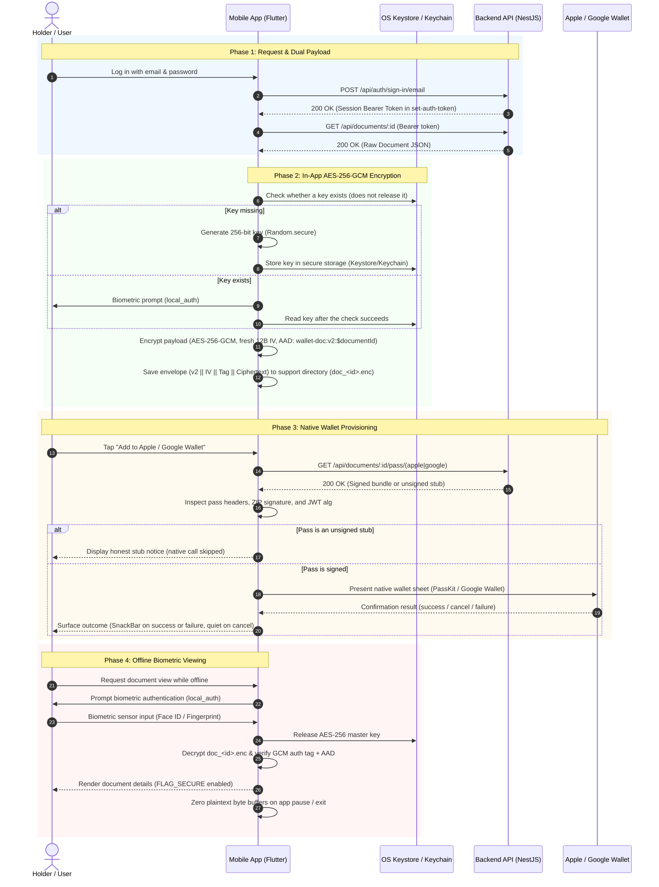

---

## Screenshots

### Admin Portal

| Screenshot | Description |
| :---: | :--- |
| 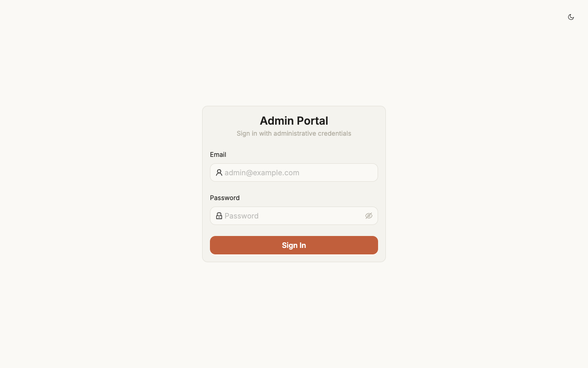 | **Admin Login**: Sign-in page with empty credentials in light theme. |
| 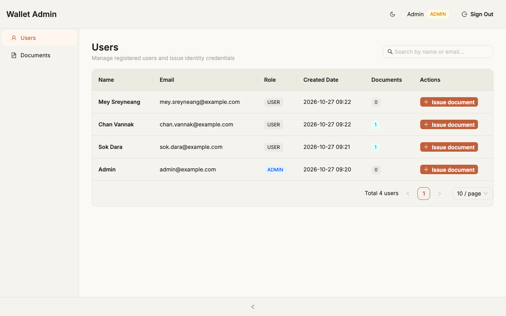 | **Users Management**: Table listing registered fictional users and their active credential counts. |
| 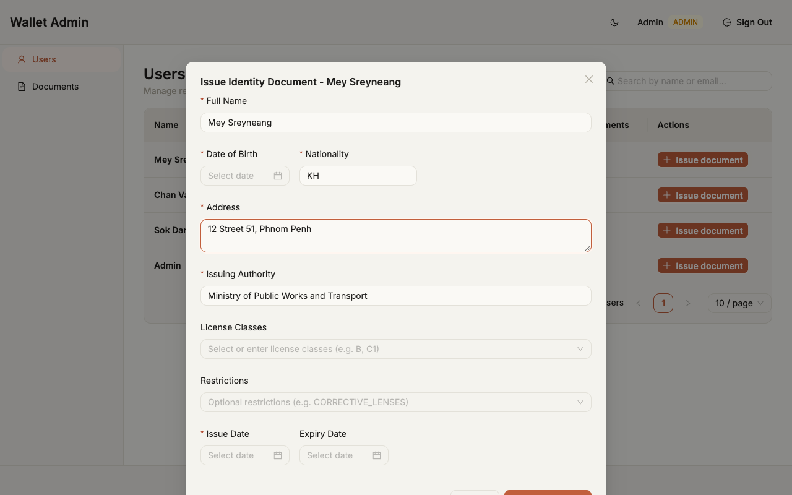 | **Issue Document**: Dialog form for issuing a driving license credential. |
| 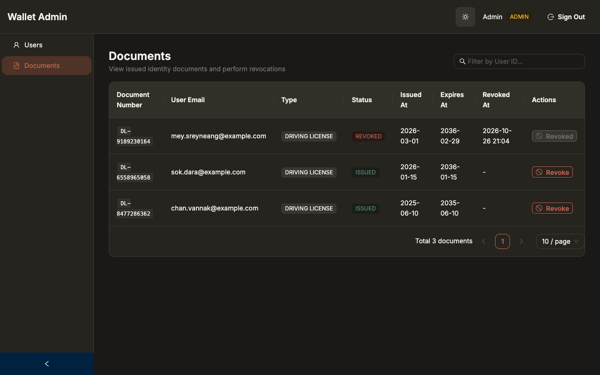 | **Documents Overview (Dark Mode)**: Credential status list showing issued and revoked records. |

### API Documentation

| Screenshot | Description |
| :---: | :--- |
| 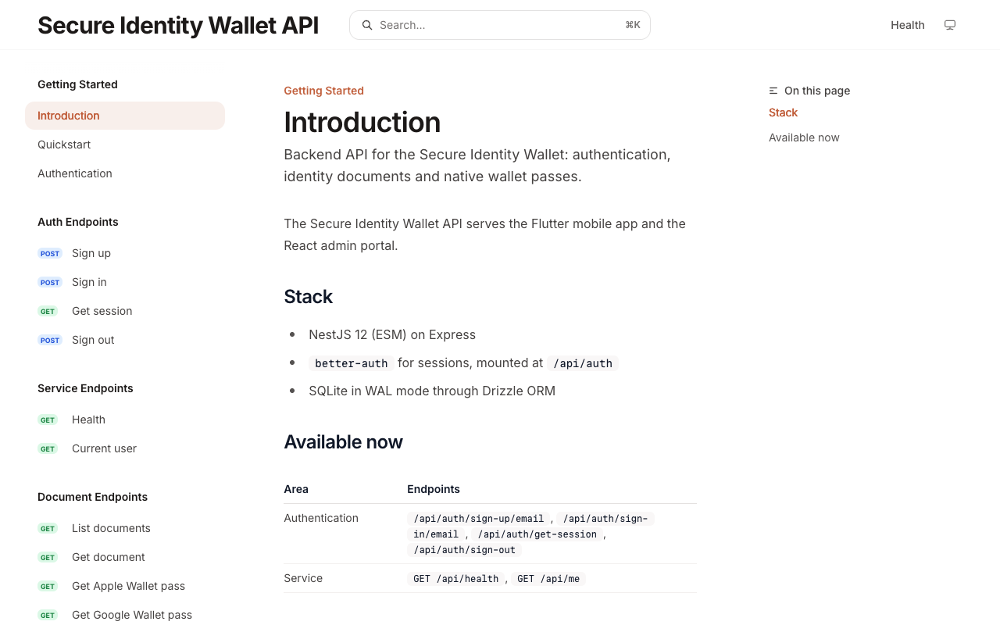 | **Introduction**: System overview and architecture guide in Mintlify. |
| 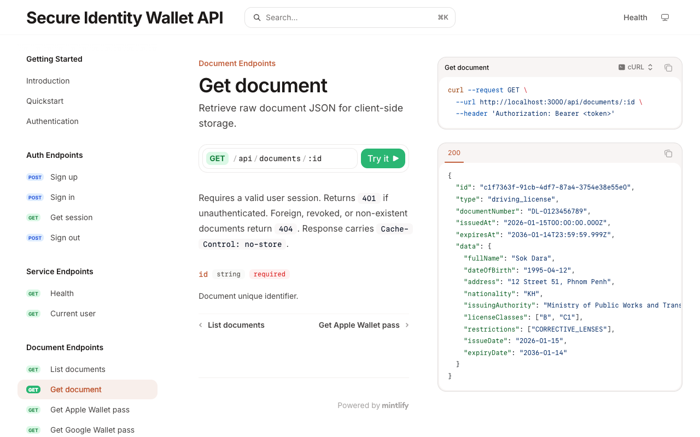 | **Endpoint Reference**: Request and response example for the raw document JSON that the mobile app encrypts. |

### Mobile Application

| Screenshot | Description |
| :---: | :--- |
| 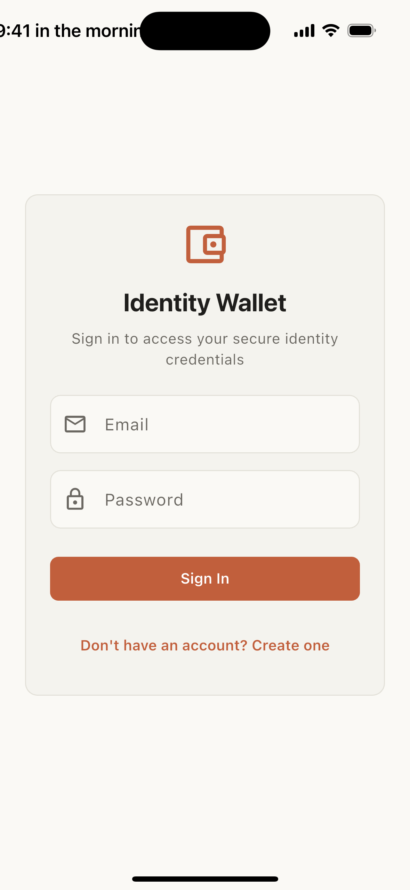 | **Mobile Login**: Initial user authentication screen. |
| 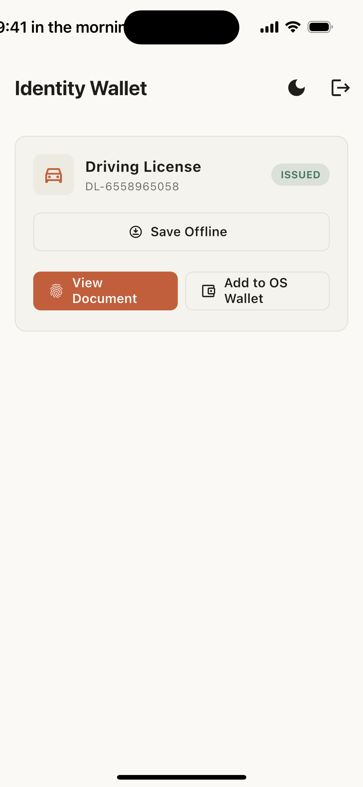 | **Wallet Home (Light Mode)**: Issued driving license card with offline caching and wallet actions. |
| 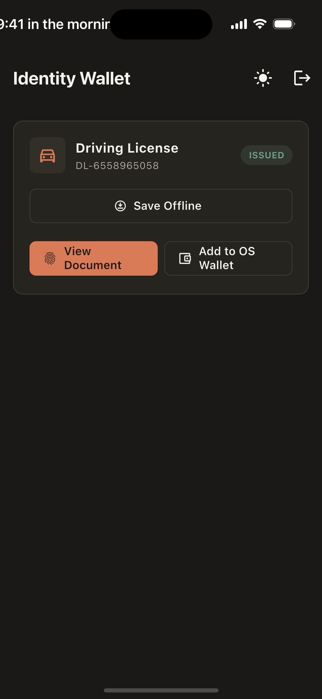 | **Wallet Home (Dark Mode)**: Credential dashboard in iOS system dark appearance. |
| 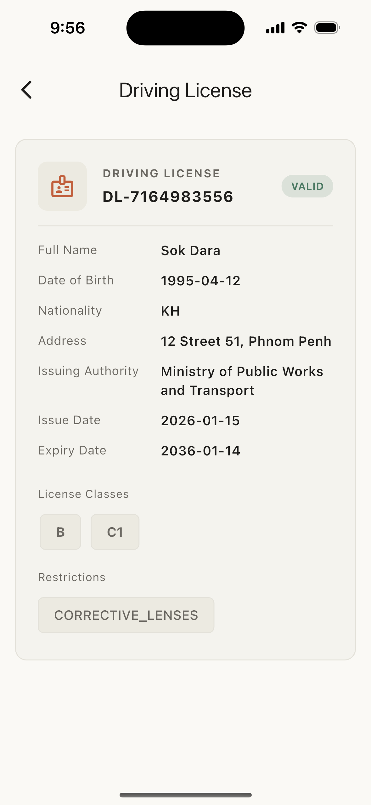 | **Decrypted Document Viewer**: Presentation view displaying decrypted identity claims. |

All credential claims, names, and identifiers displayed are fictional demonstration data. Biometric authentication was simulated using a controllable provider in the iOS Simulator for the viewer screen.

---

## Repository Layout

```text
wallet-secure-directory/
├── README.md                      # Monorepo architecture & setup guide
├── scripts/
│   ├── dev.sh                     # Orchestrated local development startup script
│   ├── stop.sh                    # Stop running development processes
│   └── .gitignore                 # Git ignore rules for scripts directory
├── backend/                       # NestJS 12 API service
│   ├── src/                       # NestJS controllers, services, modules
│   ├── test/                      # Vitest e2e and unit test suites
│   ├── drizzle/                   # Drizzle SQLite migration SQL files
│   ├── data/                      # Local SQLite WAL database storage
│   ├── scripts/                   # Database seed utilities (seed-admin.ts)
│   ├── docs/                      # Mintlify documentation workspace
│   │   ├── mint.json              # Mintlify canonical navigation & API config
│   │   ├── .gitignore             # Ignores generated docs.json
│   │   └── api-reference/         # Endpoint MDX guides
│   ├── package.json
│   └── .env.example               # Environment variables template
├── admin/                         # Vite React Ant Design administrative portal
│   ├── src/                       # React components, pages, API clients
│   ├── vite.config.ts             # Vite dev server configuration & /api proxy
│   └── package.json
├── mobile/                        # Flutter mobile application
│   ├── lib/                       # Riverpod state, UI screens, crypto & storage services
│   ├── test/                      # Flutter unit and widget tests
│   ├── tool/                      # Automation scripts (run_integration_test.sh)
│   ├── integration_test/          # End-to-end simulator integration test suite & README.md
│   ├── android/                   # Android native project configuration
│   ├── ios/                       # iOS native project configuration
│   ├── SECURITY.md                # Security architecture & cryptographic specifications
│   ├── WALLET.md                  # Native wallet provisioning architecture & contracts
│   ├── README.md                  # Mobile setup, execution flags & testing guide
│   └── pubspec.yaml
└── docs/                          # Specifications and reviews
    ├── API_CONTRACT.md            # Canonical API wire contract
    ├── reviews/                   # Security audits & code reviews
    └── theme/                     # Design tokens & color palettes
```

---

## Prerequisites

- **Node.js**: v24.x (verified on `v24.22.1` with `npm 11.x`)
- **Flutter**: v3.41.x (verified on Flutter `3.41.9` / Dart `3.11.5`)
- **OpenSSL**: For generating secure authorization secrets (`openssl rand -base64 32`)
- **Xcode & Command Line Tools** *(Optional)*: Required for iOS Simulator builds on macOS
- **Android SDK & Command Line Tools** *(Optional)*: Required for Android Emulator builds

---

## Quickstart

### Option A: Automated One-Command Startup (Recommended)

Run the root dev script, which validates dependencies, bootstraps `.env` if missing, runs database migrations, builds the backend, and launches both services:

```bash
./scripts/dev.sh
```

To include Mintlify documentation server preview:
```bash
./scripts/dev.sh --docs
```

To seed an initial admin account during startup:
```bash
./scripts/dev.sh --seed-admin admin@example.com
```

To stop all services:
```bash
./scripts/stop.sh
# Or run: ./scripts/dev.sh --stop
```

---

### Option B: Step-by-Step Manual Setup (Verified)

#### 1. Install Dependencies

```bash
# Backend dependencies
cd backend && npm install

# Admin portal dependencies
cd ../admin && npm install

# Mobile app dependencies
cd ../mobile && flutter pub get
cd ..
```

#### 2. Configure Backend Environment

Copy the example configuration and generate a 32-byte secret for Better-Auth:

```bash
cp backend/.env.example backend/.env

# Generate a cryptographically secure 32-byte key
SECRET=$(openssl rand -base64 32 | tr -d '\n')

# Populate BETTER_AUTH_SECRET in backend/.env
# On macOS:
sed -i '' "s|^BETTER_AUTH_SECRET=.*|BETTER_AUTH_SECRET=${SECRET}|" backend/.env
# On Linux:
# sed -i "s|^BETTER_AUTH_SECRET=.*|BETTER_AUTH_SECRET=${SECRET}|" backend/.env
```

#### 3. Run Database Migrations

Apply database schemas to the SQLite database:

```bash
cd backend
npm run db:migrate
```

#### 4. Seed Administrative User

Create the initial administrative account:

```bash
ADMIN_EMAIL="admin@example.com" \
ADMIN_PASSWORD="YourSecurePassword123!" \
ADMIN_NAME="Administrator" \
npm run seed:admin
```

> The password above is only an example for local development. Choose your own, and never reuse it on a deployed instance.

#### 5. Build and Start the Backend

```bash
npm run build
npm run start:prod
# Output: Nest application successfully started on port 3000
```

#### 6. Start the Admin Portal

In a new terminal:

```bash
cd admin
npm run dev
# Vite runs at http://localhost:5173 with proxy configured for /api -> http://localhost:3000
```

#### 7. Start API Documentation Preview

In a new terminal:

```bash
cd backend/docs
npx -y mint@latest dev --port 3333
# Documentation served at http://localhost:3333
```

#### 8. Run Mobile Application

In a new terminal:

```bash
cd mobile

# Running in macOS Desktop / iOS Simulator:
flutter run --dart-define=API_BASE_URL=http://localhost:3000

# Running in Android Emulator (Android maps host localhost to 10.0.2.2):
flutter run --dart-define=API_BASE_URL=http://10.0.2.2:3000
```

---

## Ports Table

| Port | Service | Description | URL |
| :--- | :--- | :--- | :--- |
| **3000** | Backend API | NestJS 12 REST API, Better-Auth endpoints, Wallet pass endpoints | `http://localhost:3000` |
| **5173** | Admin Portal | Vite React 19 + Ant Design dashboard (proxies `/api` to 3000) | `http://localhost:5173` |
| **3333** | Mintlify Docs | Mintlify local documentation preview server | `http://localhost:3333` |

---

## Environment Variables (`backend/.env`)

Refer to [`backend/.env.example`](backend/.env.example) for baseline configuration:

| Variable | Required | Default (Dev) | Description |
| :--- | :---: | :--- | :--- |
| `NODE_ENV` | Yes | `development` | Runtime environment (`development`, `production`, `test`). |
| `PORT` | Yes | `3000` | Port for the NestJS HTTP listener. |
| `DATABASE_PATH` | Yes | `./data/wallet.db` | Relative or absolute path to SQLite database file. WAL mode is enabled automatically. |
| `BETTER_AUTH_SECRET` | Yes | *Generated* | Cryptographic signing secret for Better-Auth tokens (minimum 32 characters). |
| `BETTER_AUTH_URL` | Yes | `http://localhost:3000` | Base URL used by Better-Auth for callbacks and session validation. |
| `TRUSTED_ORIGINS` | Yes | `http://localhost:5173` | Comma-delimited CORS allowed origins for credentials access. |
| `TRUST_PROXY_HOPS` | Yes (in Prod) | `0` | Number of reverse proxy hops in front of the application. |

> [!IMPORTANT]
> **Production Rule for `TRUST_PROXY_HOPS`**:
> In production (`NODE_ENV=production`), `TRUST_PROXY_HOPS` **must be set explicitly** (e.g., `1` when behind Cloudflare, Nginx, or an AWS ALB; `0` if directly exposed).
> **Consequence of misconfiguration**: If set to `0` while operating behind a reverse proxy, rate-limiting algorithms key on the reverse proxy socket IP instead of downstream client IPs. This collapses all end-users into a single IP bucket, triggering collective client lockouts.

### Optional Signed Wallet Pass Configuration

The backend supports generating cryptographically signed Apple Wallet `.pkpass` bundles and Google Wallet JWT passes when platform credentials are configured in `backend/.env`. When omitted, endpoints fall back to unsigned development stubs (`X-Pass-Stub: true` on Apple, `alg: none` on Google).

Credentials use **all-or-nothing groups**: if any variable in a group is set, all required variables in that group must be provided and file paths must be readable; otherwise, application boot validation fails.

#### Apple Wallet Pass Signing (PKCS#7 detached signature via `pkijs` and `asn1js`)

| Variable | Required for Signed Mode | Example Placeholder | Description |
| :--- | :---: | :--- | :--- |
| `APPLE_PASS_TYPE_ID` | Yes | `pass.com.example.wallet` | Registered Apple Pass Type Identifier. |
| `APPLE_TEAM_ID` | Yes | `TEAMID1234` | Apple Developer Team ID. |
| `APPLE_PASS_CERT_PATH` | Yes | `./certs/apple-pass-cert.pem` | Path to Apple Pass Type ID X.509 certificate PEM file. |
| `APPLE_PASS_KEY_PATH` | Yes | `./certs/apple-pass-key.pem` | Path to private key PEM matching the certificate. |
| `APPLE_WWDR_CERT_PATH` | Yes | `./certs/apple-wwdr.pem` | Path to Apple Worldwide Developer Relations (WWDR) certificate PEM file. |
| `APPLE_PASS_KEY_PASSPHRASE` | No | `example-passphrase` | Decryption passphrase if the private key is encrypted. |
| `APPLE_PASS_ORGANIZATION` | No | `Secure Identity Wallet` | Organization name displayed on the pass (defaults to `Secure Identity Wallet`). |

- **Boot-time Validation**: `PassSigningService.onModuleInit()` validates X.509 certificate validity dates (`notBefore` and `notAfter`), throwing on startup if expired or not-yet-valid, and warning if expiring within 30 days. It verifies that the private key matches the signer certificate (`checkPrivateKey`), decrypts with passphrase if specified, and validates the WWDR certificate.
- **Pass Fields**: Issued passes include minimal claims: holder full name, document number, license classes, and expiry date (omits date of birth and residential address).

#### Google Wallet Pass Signing (RS256 JWT)

| Variable | Required for Signed Mode | Example Placeholder | Description |
| :--- | :---: | :--- | :--- |
| `GOOGLE_WALLET_ISSUER_ID` | Yes | `1234567890123456789` | Google Pay & Wallet Console Issuer ID. |
| `GOOGLE_WALLET_SERVICE_ACCOUNT_EMAIL` | Yes | `wallet-sa@project.iam.gserviceaccount.com` | Google Cloud Service Account email. |
| `GOOGLE_WALLET_PRIVATE_KEY_PATH` | Yes | `./certs/google-wallet-private-key.pem` | Path to RSA private key PEM file for JWT signing. |
| `GOOGLE_WALLET_CLASS_SUFFIX` | No | `identity_wallet` | Class identifier suffix (combined with Issuer ID). |
| `GOOGLE_WALLET_ORIGINS` | No | `https://wallet.example.com` | Comma-delimited list of allowed web origins. |

- **Boot-time Validation**: Validates that the private key exists, is readable, and loads key material for RS256 JWT signing.
- **Pass Fields**: Generic pass objects include minimal claims: holder full name, document number, license classes, and expiry date (omits date of birth and residential address).

---

## How the Tests Run

Every component in the repository has dedicated automated test suites. None of the test runners require a pre-configured database service:

- **Backend**:
  ```bash
  cd backend
  npm test
  ```
  `npm test` automatically triggers `pretest` (`nest build`) first to verify TypeScript compilation, then runs Vitest (`vitest run`). Tests include e2e API routes against a temporary SQLite database in WAL mode and unit tests for signed passes, tamper detection, stubs, and boot credentials validation. Typechecking can be run separately via `npm run typecheck`.

- **Admin Portal**:
  ```bash
  cd admin
  npm test
  ```
  Executes Vitest (`vitest run`) with React Testing Library, testing admin user management, document issuance modals, revocation flows, and API client proxies. Production bundling and type checks run via `npm run build`.

- **Mobile Unit & Widget Tests**:
  ```bash
  cd mobile
  flutter analyze
  flutter test
  ```
  Runs Dart static analysis and Flutter unit/widget tests. Covers AES-256-GCM encryption/decryption, envelope v2 validation, AAD binding, path traversal defenses, key migration, invalidation recovery, UI debounce, and lifecycle memory zeroing.

- **Mobile Simulator Integration Tests**:
  ```bash
  mobile/tool/run_integration_test.sh
  ```
  An automated one-command runner that bootstraps a private backend on an isolated port (default: 3170) with a dedicated database and seed data, boots an iOS simulator, and executes the complete security integration test (`e2e_faked_biometrics_simulator_test.dart`). On exit or termination, the runner performs PID-based cleanup of the backend and deletes temporary simulators and databases. Inspect options via `mobile/tool/run_integration_test.sh --help`.

---

## API Summary

The canonical contract for all endpoints is maintained in [`docs/API_CONTRACT.md`](docs/API_CONTRACT.md).

### Core Endpoints Overview

- **Authentication (`/api/auth`)**:
  - `POST /api/auth/sign-up/email`: Register user with `{ name, email, password }`.
  - `POST /api/auth/sign-in/email`: Authenticate user; returns session token and sets `set-auth-token` header.
  - `GET /api/auth/get-session`: Retrieve active user session.
  - `POST /api/auth/sign-out`: Terminate session and invalidate auth cookies/tokens.
- **Service Endpoints (`/api`)**:
  - `GET /api/health`: Health status and SQLite journal mode (`{"status":"ok","journalMode":"wal"}`).
  - `GET /api/me`: Returns current authenticated user record.
- **Identity Document Endpoints (`/api/documents`)**:
  - `GET /api/documents`: List user's active, non-revoked identity documents.
  - `GET /api/documents/:id`: Retrieve raw JSON claims of a specific document for mobile encryption.
  - `GET /api/documents/:id/pass/apple`: Download Apple `.pkpass` bundle (signed PKCS#7 package when configured; unsigned stub with `X-Pass-Stub: true` otherwise).
  - `GET /api/documents/:id/pass/google`: Retrieve Google Wallet save URL & JWT (signed RS256 JWT when configured; unsigned stub with `alg: none` otherwise).
- **Administrative Endpoints (`/api/admin`)** *(Requires `role: "admin"`)*:
  - `GET /api/admin/users`: Paginated list of users with active document counts.
  - `GET /api/admin/documents`: Paginated list of issued documents across all users.
  - `POST /api/admin/documents`: Issue a new document to a specified `userId`.
  - `POST /api/admin/documents/:id/revoke`: Revoke an issued document (idempotent).

---

## Status and Limitations

To maintain full engineering transparency, the following constraints and current implementation limitations are explicitly documented:

1. **Wallet Pass Signing & Unsigned Development Stubs**:
   - When platform credentials (`APPLE_*` and `GOOGLE_*`) are configured, the backend generates cryptographically signed `.pkpass` bundles and RS256-signed JWTs.
   - When credentials are not configured, the endpoints generate unsigned development stubs (`X-Pass-Stub: true`, `alg: none`).
   - The mobile application's native wallet provisioner inspects pass payloads and rejects unsigned stubs defensively before calling any native channel (`WalletProvisionStubError`), displaying an honest notice to the user.
   - For passes that look signed, the mobile app invokes native sheets via `PlatformNativeWalletBridge` (PassKit `WalletChannelHandler.swift` on iOS, `add_to_google_wallet` on Android), but out-of-process system sheets have not been verified on physical hardware.
2. **App-Level Biometric Gating vs. OS-Bound Keys**:
   - By default (`OS_BOUND_KEY=false`), the biometric gate in the mobile app is implemented via `local_auth` in Flutter Dart code (`biometricOnly: true`). The symmetric key stored in Android Keystore / iOS Keychain is not hardware-bound to the biometric state by the OS.
   - An opt-in mode `--dart-define=OS_BOUND_KEY=true` configures `flutter_secure_storage` to enforce OS-level biometric release (`biometryCurrentSet` + `userPresence` on iOS Keychain; `AndroidOptions.biometric` on Android) with key migration and invalidation recovery, but this mode is unverified on physical hardware.
3. **Hardware-Level Security Testing Limitations**:
   - Security features including biometric authentication, Android `WindowManager.LayoutParams.FLAG_SECURE` screen recording prevention, iOS `SceneDelegate` privacy snapshot overlays, and native wallet presentation sheets were verified in automated unit test suites and simulator environments, but **have not yet been validated on physical production hardware**.
4. **Android Release Build Signing Key**:
   - In `mobile/android/app/build.gradle.kts`, the `release` build type currently inherits the debug signing configuration (`signingConfigs.getByName("debug")`). A dedicated production release keystore and environment-driven CI signing workflow must be established prior to public Play Store distribution.
5. **Open Registration & Unverified Email**:
   - User sign-up (`POST /api/auth/sign-up/email`) is open and there is no email verification, so any email address can register an account. `better-auth`'s built-in rate limiter is enabled only when `NODE_ENV=production`; development has none. A real deployment needs email verification and a decision on who may register.
6. **Known Dependency Advisories**:
   - Running `cd backend && npm audit --omit=dev` reports 7 vulnerabilities (4 moderate, 3 high):
     - `esbuild <=0.24.2` (moderate severity, GHSA-67mh-4wv8-2f99): pulled in via `@esbuild-kit/core-utils` under `drizzle-kit`. Unreachable in production runtime.
     - `multer 2.0.0 - 2.4.0` (high severity, GHSA-q7qp-rjg7-q26m): pulled in via `@nestjs/platform-express` under `@nestjs/core`. Unreachable in production runtime as no route handles file or multipart uploads.
     - `node-forge` is no longer present in the codebase; it was replaced by `pkijs` and `asn1js`.
   - The suggested automatic fixes are breaking downgrades, so they are not applied.
7. **Placeholder Identity**:
   - The mobile app id is the Flutter default `com.example.wallet_app` and the repository has no license file yet.
